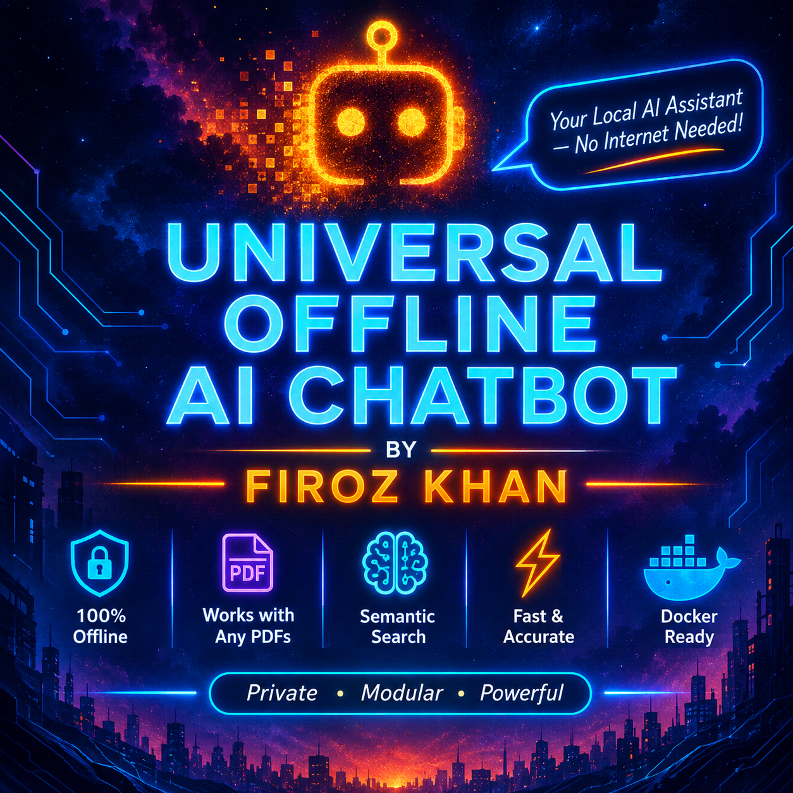
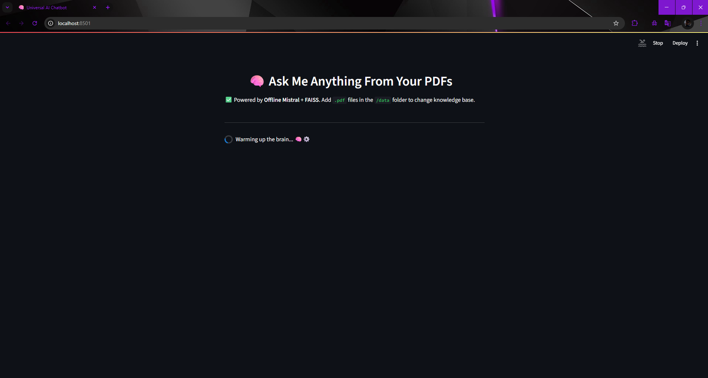
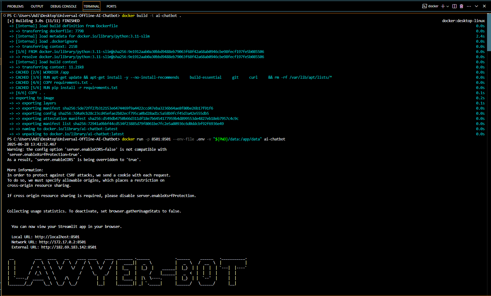

# 🌐 Universal Offline AI Chatbot

> Build your own domain-specific chatbot — offline, modular, and blazing fast.

[](https://www.python.org/downloads/release/python-3110/)

[](https://pypi.org/project/universal-offline-ai-chatbot/)


The **Universal Offline AI Chatbot** a python-based **Retrieval-Augmented Generation (RAG)** application that allows users to interact with their PDF documents using a locally hosted Large Language Model (LLM).

Built with **LangChain, Ollama, HuggingFace Embeddings, FAISS, and Streamlit,** this chatbot retrieves relevant information from uploaded documents and generates context-aware responses without depending on cloud-based AI APIs for inference.

 <br/>

> **GitHub Link:** [https://github.com/Firoz9701/Universal-Offline-AI-Chatbot](https://github.com/Firoz9701/Universal-Offline-AI-Chatbot) <br/>

---

## ✨ Key Features

* 🔐 **Privacy-focused**: Processes documents using locally hosted AI models.
* 📄 **PDF-Based Question Answering**: Ask questions about your own PDF documents.
* 🧠 **Semantic Search**: Retrieves relevant information using HuggingFace embeddings.
* ⚡️ **Fast Retrieval**: Uses **FAISS** for efficient vector similarity search.
* 🤖 **Local LLM Integration**: Runs Mistral through Ollama.
* 🔗 **RAG Architecture**: Generates contextual answers using retrieved document content.
* 🧩 Modular, extendable architecture (Streamlit frontend + CLI).
* 🖥️ **Interactive Interface**: Streamlit-based chatbot frontend.
* 🐳 Docker-ready for deployment
* ✅ Built-in CI/CD check via GitHub Actions
* 🎯 Fully reproducible setup via PowerShell script or Docker

---

## 🧱 Tech Stack

| Layer        | Stack                                       |
| ------------ | ------------------------------------------- |
| LLM          | `mistral:instruct` via Ollama               |
| Embeddings   | `all-MiniLM-L6-v2` via SentenceTransformers |
| Vector Store | FAISS (in-memory + disk)                    |
| Framework    | LangChain (v0.2+)                           |
| Language     | Python 3.11+                                |
| UI           | Streamlit                                   |
| Container    | Docker                                      |
| CI/CD        | GitHub Actions (`.github/workflows/python.yml`) |

---

## 🏗️ RAG Architecture

The chatbot follows a Retrieval-Augmented Generation workflow:

1. Document Loading: Load PDF documents provided by    the user.

2. Text Extraction and Chunking: Extract PDF text    and divide it into smaller chunks.

3. Embedding Generation: Convert text chunks into    vector embeddings using HuggingFace.

4. Vector Storage: Store the embeddings in a FAISS    vector database.

5. Similarity Search: Search for document chunks    relevant to the user's question.

6. Context Retrieval: Pass the retrieved content to    the language model.

7. Response Generation: Use the locally running    Mistral model through Ollama to generate an    answer.

8. Answer Display: Display the response through the    chatbot interface.

---

## 📁 Project Structure

```
Universal-Offline-AI-Chatbot/
│
├── data/                   # Place your PDF documents here
│   └── Try.pdf
│
├── Screenshots/           # UI snapshots
│   ├── Cover.png
│   ├── Loading_Screen.png
│   ├── Running_the_Model.png
│   └── Docker_Build_Run.png 
│   
│   
│
├── src/                   # Modular source code
│   ├── chunker.py
│   ├── config.py
│   ├── embedding.py
│   ├── loader.py
│   ├── model_loader.py
│   ├── prompts.py
│   ├── qa_chain.py
│   ├── utils.py
│   └── vectorstore.py
│
├── vectorstore/           # Local FAISS vector 
│   
│
├── Bot.py                 # CLI script
├── Bot.ipynb              # Jupyter notebook version
├── main.py                # Entry-point (optional)
├── streamlit_app.py       # Frontend UI (Streamlit)
├── requirements.txt       # Python dependencies
├── setup.ps1              # PowerShell setup script
├── Dockerfile             # Docker image definition
├── .dockerignore
├── setup.py             # PyPI config
├── pyproject.toml       # Modern packaging metadata
├── MANIFEST.in          # Source packaging rules
├── .gitignore                   
├── README.md
└── LICENSE
```
---

## 🧰 Setup Instructions

### 🖥️ One-Click Setup (Windows Only)

```powershell
.\setup.ps1
```

This will:

* Create virtual env
* Install dependencies
* Pull Mistral via Ollama
* Ask for Hugging Face token
* Build Docker image

---

⚙️ **Installation and Setup**

**Prerequisites**

Make sure you have installed:

Python 3.11 or later

Git

Ollama

Docker (optional, for containerized execution)

1. **Clone the Repository**

git clone https://github.com/Firoz9701/Universal-Offline-AI-Chatbot.git

cd Universal-Offline-AI-Chatbot

2. **Create a Virtual Environment**

python -m venv venv

Activate the environment:

Windows:

.\venv\Scripts\Activate.ps1

Linux / macOS:

source venv/bin/activate

3. **Install Dependencies**

pip install -r requirements.txt

4. **Install and Configure Ollama**

Download and install Ollama from:

https://ollama.com/

Pull the Mistral model:

ollama pull mistral:instruct

Make sure Ollama is running before starting the chatbot.

5. **Configure Environment Variables**

If your project configuration requires a HuggingFace token, create a local .env file in the project root.

Example:

HF_TOKEN=your_huggingface_token

Replace the example value with your own token.

Security note: Never commit your actual .env file or API tokens to GitHub. Keep .env in .gitignore. If your application does not require a HuggingFace token, you can skip this step.

🚀 **Running the Application**

Option 1: Command-Line Interface

Run:

python Bot.py

Option 2: Streamlit Web Interface

Run:

streamlit run streamlit_app.py

Open the local URL displayed in your terminal to interact with the chatbot.

Option 3: Jupyter Notebook

Open Bot.ipynb in Jupyter Notebook or JupyterLab and execute the cells to explore the chatbot workflow interactively.

---

## 🐳 Docker Support

You can also build and run the application using Docker.

**Build the Docker image:**

docker build -t universal-offline-ai-chatbot .

**Run the container:**

docker run -p 8501:8501 universal-offline-ai-chatbot

> Access the chatbot at [http://localhost:8501](http://localhost:8501)

**Note**: The container must be able to communicate with the Ollama service hosting the Mistral model. Configure the Ollama host appropriately for your Docker environment.

---

## 📄 Using Your Own PDF Documents

1. Start the chatbot application.

2. Provide or configure the PDF documents you want    to query, following the application's document-   loading setup.

3. Allow the application to process the documents   and create their embeddings.

4. Ask questions related to the document content.

5. The chatbot retrieves relevant information and    generates responses using the local LLM.

---

📸 Screenshots

#### ⏳ Loading Screen



#### 🤖 Chat in Action


#### 🐳 Building the Image



---

💡 Key Technical Concepts

This project demonstrates practical implementation of:

* Generative AI and Large Language Models (LLMs)

* Retrieval-Augmented Generation (RAG)

* LangChain-based application development

* Local LLM integration using Ollama

* Text embeddings and semantic search

* FAISS vector databases

* PDF document processing

* Streamlit application development

* Docker containerization

---

## 🧑‍💻 Author

**Firoz Khan** <br/>
Software Developer | Full Stack Developer <br/>
[GitHub](https://github.com/Firoz9701/Universal-Offline-AI-Chatbot) 

⭐ If you find this project useful, consider giving the repository a star!

---
